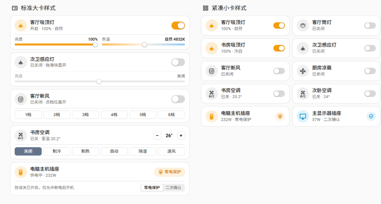
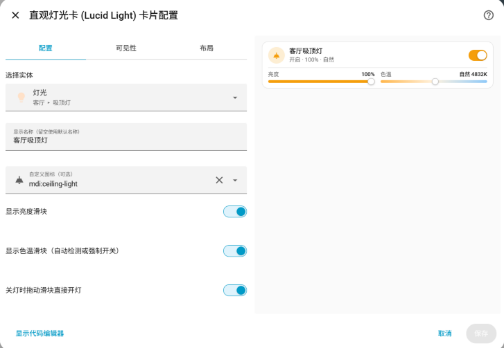

# Lucid Cards（直观卡片）

[](https://github.com/kukushouhou/ha-lucid-cards/releases)
[](https://github.com/hacs/integration)
[](./LICENSE)

[English Documentation](./README_en.md)

一套面向 Home Assistant 的紧凑型前端卡片包。设计贴合国内家庭常用的米家/墙面中控屏操作习惯：保留右上角独立拨动开关，为所有滑块和档位配上清晰的文字标注与数值，无需点进二级弹窗即可在首页直接调节亮度、色温、风速、温度及插座常电防误关保护；四款卡片均同时提供 **标准大卡样式** 与 **紧凑半宽小卡样式（`compact: true`）**。

[](https://my.home-assistant.io/redirect/hacs_repository/?owner=kukushouhou&repository=ha-lucid-cards&category=plugin)

## 实机效果预览

### 标准大卡样式与紧凑小卡样式对照



### 原生可视化配置界面（免写 YAML）



## 包含的四张卡片

- **直观灯光卡（`custom:lucid-light-card`）**：右上角独立拨动开关，大卡模式下方并排显示带文字标签的「亮度 %」与「色温 K」长滑块（单亮度灯自动单列铺满，支持关灯拖滑块直开）；小卡模式单行半宽展示实时亮度/色温状态与独立开关。
- **直观风扇/新风卡（`custom:lucid-fan-card`）**：右上角独立拨动开关，大卡模式按设备步进自动生成「1档～N档」直选按钮（1% 无级调速风扇自动归纳为 5 档按钮）；小卡模式单行显示当前档位与开关。
- **直观空调温控卡（`custom:lucid-climate-card`）**：大卡模式右上角紧凑加减调温按钮，下方按设备支持的运行模式生成中文直选按钮（关闭、制冷、制热、自动、除湿、送风）；小卡模式单行显示运行模式、温度与独立开关。
- **直观防误关插座卡（`custom:lucid-safe-switch-card`）**：专为电脑主机、NAS、冰箱、软水机插座设计，内置「常电保护（仅允许断电后开机，禁止页面断电）」与「二次确认（连点两次才断电）」两种保护模式，支持关联功率传感器显示实时瓦数。

## 安装方式

### 一键跳转 HACS 安装（推荐）

点击上方蓝色的 **Open your Home Assistant instance** 按钮，浏览器会自动跳入你的 Home Assistant 并在 HACS 中预填好仓库地址与类别，确认添加后点击下载并刷新页面即可。

### 手动在 HACS 中添加自定义仓库

1. 打开 Home Assistant 中的 **HACS** -> 右上角菜单 -> **自定义存储库 (Custom repositories)**。
2. 存储库地址填写 `https://github.com/kukushouhou/ha-lucid-cards`，类别选择 **控制面板 (Dashboard)**。
3. 点击下载并刷新浏览器页面即可在「添加卡片」面板中直接选用。

### 手动安装

1. 从 Releases 下载 `lucid-cards.js`，放入 Home Assistant 配置目录下的 `www/lucid-cards.js`。
2. 在 **设置 -> 仪表盘 -> 右上角菜单 -> 资源** 中添加 `/local/lucid-cards.js`，类型选 **JavaScript 模块**。

## 配置说明

所有卡片均支持 **Home Assistant 可视化配置界面**（添加卡片时搜索 `直观` 或 `Lucid` 即可下拉选择实体，免手写 YAML）。如需使用 YAML，参考以下示例：

### 灯光卡示例

```yaml
type: custom:lucid-light-card
entity: light.living_ceiling
name: 客厅吸顶灯
compact: false          # 设为 true 可切换为单行半宽紧凑小卡
show_brightness: true
show_color_temp: true
drag_to_turn_on: true
```

### 风扇与新风卡示例

```yaml
type: custom:lucid-fan-card
entity: fan.living_fresh_air
name: 客厅新风
compact: false          # 设为 true 可切换为单行半宽紧凑小卡
# gears: 6              # 可选，留空时按设备步进自动识别
```

### 空调温控卡示例

```yaml
type: custom:lucid-climate-card
entity: climate.study_ac
name: 书房空调
compact: false          # 设为 true 可切换为单行半宽紧凑小卡
step: 0.5
```

### 防误关插座卡示例

```yaml
type: custom:lucid-safe-switch-card
entity: switch.pc_host_outlet
power_entity: sensor.pc_host_power
name: 电脑主机插座
protection: lock          # lock（常电保护，仅允许开机）或 confirm（二次确认断电）
show_mode_switch: true    # 是否在大卡底部显示「常电保护 / 二次确认」切换栏
compact: false            # 设为 true 可切换为单行半宽紧凑小卡
```

## 本地构建与测试

```bash
npm install
npm run verify
```

构建产物位于 `dist/lucid-cards.js`。

## 开源协议

MIT License
