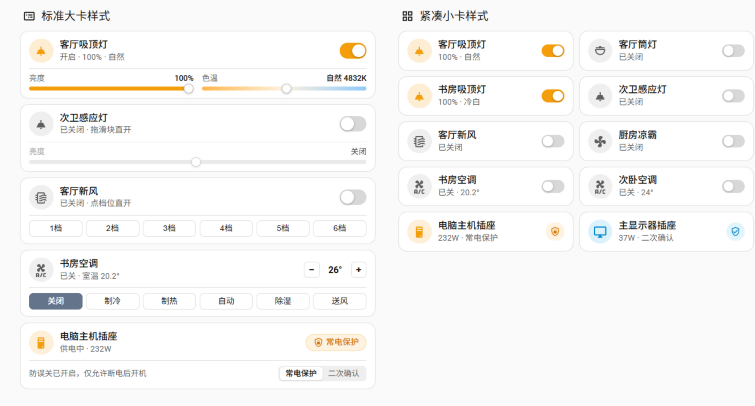
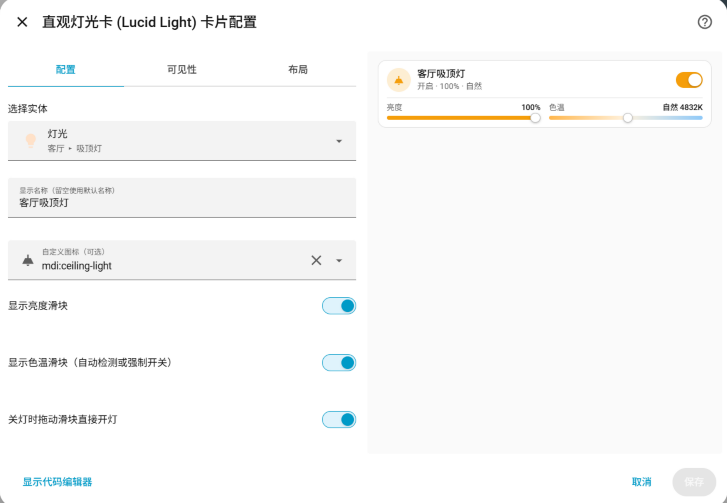

# Lucid Cards

[](https://github.com/kukushouhou/ha-lucid-cards/releases)
[](https://github.com/hacs/integration)
[](./LICENSE)

[简体中文说明](./README.md)

Compact, explicitly labeled Home Assistant Lovelace cards for lights, fans, climate units, and protected power outlets. Every card supports both **Standard Full-Width Mode** and **Compact Half-Width Mode (`compact: true`)**, with explicit switches, readable labels, and native GUI editors.

[](https://my.home-assistant.io/redirect/hacs_repository/?owner=kukushouhou&repository=ha-lucid-cards&category=plugin)

## Screenshots

### Standard Mode vs. Compact Half-Width Mode



### Native Visual Card Editor



## Included Cards

- **Lucid Light Card (`custom:lucid-light-card`)**: Explicit top-right toggle switch with side-by-side labeled Brightness (`%`) and Color Temperature (`K`) sliders. Automatically adapts to brightness-only or on/off lights and supports dragging while off to turn on.
- **Lucid Fan Card (`custom:lucid-fan-card`)**: Explicit top-right toggle switch with auto-generated speed gear buttons (`S1..SN`, or 5 clean steps for 1%-step DC fans).
- **Lucid Climate Card (`custom:lucid-climate-card`)**: Compact temperature stepper (`− / ° / +`) on the header and direct HVAC mode buttons underneath.
- **Lucid Safe Switch Card (`custom:lucid-safe-switch-card`)**: Designed for PC hosts, NAS servers, refrigerators, and routers. Supports `lock` mode (turn-on only; turning off is blocked) and `confirm` mode (double-tap required to cut power), plus optional live wattage display.

## Installation

### Via HACS (Custom Repository)

1. Open **HACS** in Home Assistant -> top-right menu -> **Custom repositories**.
2. Add `https://github.com/kukushouhou/ha-lucid-cards` with category **Dashboard**.
3. Download **Lucid Cards** and reload your browser.

### Manual Installation

1. Download `lucid-cards.js` from Releases into `<config>/www/lucid-cards.js`.
2. Add `/local/lucid-cards.js` under **Settings -> Dashboards -> Resources** as a **JavaScript Module**.

## Configuration

All four cards include native Home Assistant **Visual Card Editors** (`ha-form`), so you can pick entities and options directly in the UI without writing YAML.

```yaml
type: custom:lucid-light-card
entity: light.living_ceiling
name: Living Ceiling Light
show_brightness: true
show_color_temp: true
drag_to_turn_on: true
```

## Development

```bash
npm install
npm run verify
```

## License

MIT License
